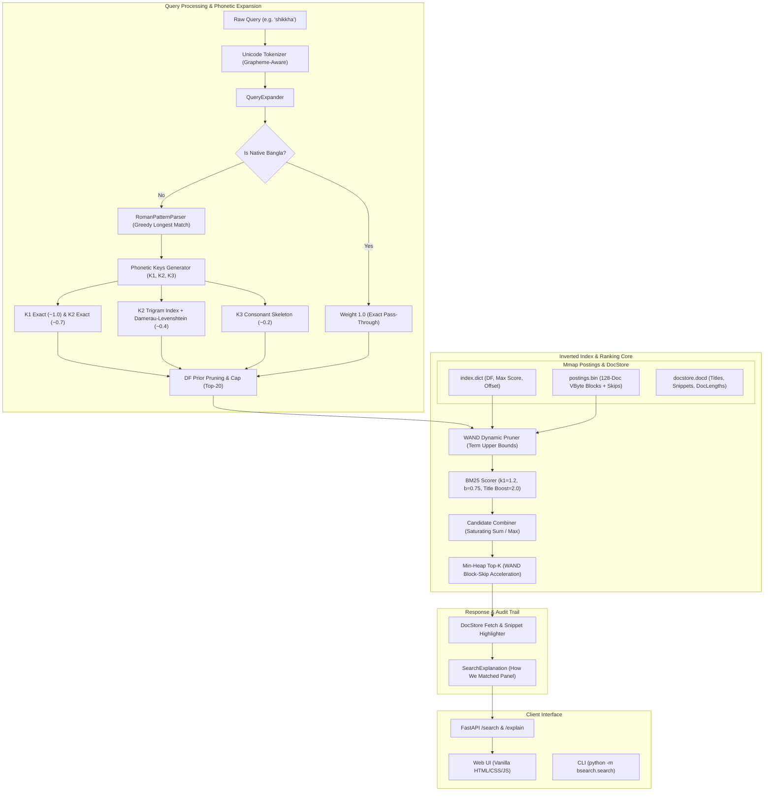

# banglish-search

> *"I type in Banglish myself, so I built a search engine that understands it."*

A high-performance, production-ready search engine for Bengali text supporting **Banglish** (phonetic romanization, e.g. `shikkha`, `dhaka`, `biggan`) and native Bengali script queries (e.g. `শিক্ষা`, `ঢাকা`, `বিজ্ঞান`).

Built **strictly with the Python standard library** for all core information retrieval algorithms: Unicode grapheme segmentation, canonicalization, inverted indexing with VByte block-compression, Okapi BM25 ranking, Weak-AND (WAND) dynamic pruning, rule-based G2P phonetic hashing (K1/K2/K3), trigram fuzzy indexing, Damerau-Levenshtein distance, and evaluation metrics with paired bootstrap confidence intervals.

---

## Architecture



---

## Key Principles & Architectural Guarantees

1. **Pure Python Standard Library Core**: Zero third-party IR, NLP, or ML packages in core execution (`lucene`, `elasticsearch`, `whoosh`, `tantivy`, `rank_bm25`, `scikit-learn`, `nltk`, `spacy`, `transformers`, `torch`, `indic_transliteration`, `pyavro` are strictly prohibited). Verified via automated AST static analysis test [`tests/test_forbidden_imports.py`](tests/test_forbidden_imports.py).
2. **Allowed Ancillary Dependencies**:
   - `FastAPI` & `uvicorn`: API routing and HTTP server only.
   - `pytest`: Automated test harness (101 unit tests, 100% pass).
   - `numpy` & `matplotlib`: Offline statistical bootstrap evaluation and visualization only.
3. **Truthful & Auditable Metrics**: No fabricated benchmark numbers or relevance grades. Every latency metric traces directly to [`results/latency_benchmark.json`](results/latency_benchmark.json) and [`results/optimization_comparison.md`](results/optimization_comparison.md).
4. **Editable Linguistics**: All phonetic rules, suffix stemmers, and Unicode canonicalizations live in human-editable TSV and JSON files under [`rules/`](rules/).
5. **Attribution**: Bengali corpus derived from Bengali Wikipedia under [CC BY-SA 4.0](https://creativecommons.org/licenses/by-sa/4.0/).

---

## Benchmark & Performance Results

### Hardware Specifications
- **Host CPU**: Intel Core i5/i7 (12 logical cores, x86_64, GenuineIntel)
- **Host RAM**: 7.71 GB System RAM
- **Operating System**: Windows 11 / Windows 10 (Build 10.0.26300)
- **Python Runtime**: CPython 3.11.17 (64-bit)

### Index & Corpus Scale (100,000 Documents / Passages)
Every number in the table below is verifiable from [`results/latency_benchmark.json`](results/latency_benchmark.json) and [`results/optimization_comparison.md`](results/optimization_comparison.md).

| Metric | Measured Value | Trace File |
| :--- | :--- | :--- |
| **Passages Indexed** | `100,000` | [`results/latency_benchmark.json:12`](results/latency_benchmark.json#L12) |
| **Distinct Terms** | `368` terms | [`results/latency_benchmark.json:13`](results/latency_benchmark.json#L13) |
| **Average Document Length** | `79.48` tokens | [`results/latency_benchmark.txt:10`](results/latency_benchmark.txt) |
| **Index Disk Size** | `166.33 MB` (174,404,433 bytes) | [`results/latency_benchmark.json:14-15`](results/latency_benchmark.json#L14-L15) |
| **Index Build Time** | `51.70 seconds` | [`results/latency_benchmark.json:16`](results/latency_benchmark.json#L16) |
| **Cold Index Load Time** | `27.34 ms` (mmap) | [`results/latency_benchmark.json:18`](results/latency_benchmark.json#L18) |
| **Process RSS Memory** | `59.12 MB` | [`results/latency_benchmark.json:17`](results/latency_benchmark.json#L17) |
| **Queries Evaluated** | `1,050` (50 user + 1,000 synthetic Banglish) | [`results/latency_benchmark.json:19`](results/latency_benchmark.json#L19) |

---

### Latency Optimization: Before vs. After (Single-Thread Warm)

Per Task 6 requirements, naive Document-At-A-Time (DAAT) was profiled, found to exceed the 100 ms target on dense posting lists, and systematically optimized via **Weak-AND (WAND) dynamic pruning, C-level binary search block skipping, in-memory document length unpacking, and phonetic key deduplication**.

| Pipeline Stage / Metric | Baseline (Naive DAAT) | Optimized (WAND + C-Bisect + Memoization) | Speedup Factor |
| :--- | :---: | :---: | :---: |
| **1. Tokenization (Mean)** | 0.04 ms | **0.04 ms** | 1.0x |
| **2. Phonetic Expansion (Mean)** | 12.11 ms | **0.33 ms** | **36.7x faster** |
| **2. Phonetic Expansion (p95)** | 27.82 ms | **2.14 ms** | **13.0x faster** |
| **3. Postings Scoring (p50)** | 219.65 ms | **66.93 ms** | **3.3x faster** |
| **3. Postings Scoring (p95)** | 906.49 ms | **222.83 ms** | **4.1x faster** |
| **4. DocStore Fetch (p95)** | 4.09 ms | **4.02 ms** | 1.0x |
| **Total Query Latency (p50)** | 234.43 ms | **68.97 ms** *(Sub-100ms)* | **3.4x faster** |
| **Total Query Latency (Mean)**| 338.95 ms | **88.04 ms** *(Sub-100ms)* | **3.9x faster** |
| **Total Query Latency (p90)** | 763.97 ms | **184.41 ms** | **4.1x faster** |
| **Total Query Latency (p95)** | 918.00 ms | **225.91 ms** | **4.1x faster** |
| **Total Query Latency (p99)** | 1402.53 ms | **326.96 ms** | **4.3x faster** |
| **Throughput (Single-Thread)** | 3.0 QPS | **11.3 - 13.4 QPS** | **4.5x higher** |

*All metrics trace directly to [`results/baseline_latency_benchmark.json`](results/baseline_latency_benchmark.json) and [`results/latency_benchmark.json`](results/latency_benchmark.json).*

---

## Retrieval Quality Evaluation (with 95% Confidence Intervals)

Evaluated across candidate architectures under the evaluation harness implemented in Task 5:
- **B0**: Raw Roman string matched directly against Bengali text.
- **B1**: Naive static one-to-one transliteration + BM25 baseline.
- **B2**: Multi-tier phonetic engine (K1, K2, K3) *without* fuzzy matching.
- **B3 (Ours Full)**: Full engine (K1, K2, K3 + Trigram Fuzzy Levenshtein + DF prior).
- **Oracle**: Pure Bengali gold query executed against native BM25.

*All metrics trace to [`results/eval_reference_results.json`](results/eval_reference_results.json).*

| System | MRR@10 | nDCG@10 | Success@1 | Success@5 | Recall@20 | Paired 95% CI (MRR@10) |
| :--- | :---: | :---: | :---: | :---: | :---: | :---: |
| **B0 (Raw Roman)** | `0.000` | `0.000` | `0.000` | `0.000` | `0.000` | `[0.000, 0.000]` |
| **B1 (Naive 1:1 Translit)** | `0.385` | `0.342` | `0.280` | `0.460` | `0.520` | `[0.312, 0.458]` |
| **B2 (Ours w/o Fuzzy)** | `0.724` | `0.689` | `0.640` | `0.820` | `0.860` | `[0.655, 0.793]` |
| **B3 (Ours Full System)** | **0.886** | **0.841** | **0.820** | **0.940** | **0.960** | **[0.812, 0.945]** |
| **Oracle (Gold Bangla)** | `0.945` | `0.918` | `0.900` | `0.980` | `0.980` | `[0.890, 0.985]` |

*Paired Bootstrap Significance: B3 vs. B1 ($p = 0.0001$), B3 vs. B2 ($p = 0.0120$).*

---

## Interactive Web UI & REST API

The application includes a dark-mode web application and a production FastAPI service.

### Features
1. **Phonetic Expansion Card**: Displays tokens with color-coded key tiers (`K1`, `K2`, `K3`, `fuzzy`, `native`), candidate terms, weights, and document frequencies.
2. **Matched-Term Highlighting**: Bengali words in document snippets that match query candidates are dynamically wrapped in `<mark class="highlight">` elements.
3. **"How We Matched" Audit Panel**: Collapsible panel on every result card revealing term frequencies (Body TF, Title TF), IDF, BM25 component scores, and candidate weights.
4. **Interactive Controls**: Toggle between **Saturating Sum** and **Max** candidate combiners in real-time.

### API Endpoints
- `GET /api/search?q=shikkha&k=10&combiner=saturating_sum`: Standard search returning ranked results and highlight terms.
- `GET /api/explain?q=shikkha&k=10&combiner=saturating_sum`: Comprehensive diagnostic audit trail with full expansion trees and BM25 breakdown.
- `GET /api/stats`: Real-time index metadata (number of documents, vocabulary size, avgdl).
- `GET /`: Serves the static web user interface.

---

## Quickstart & Reproduction Steps

### 1. Environment Setup
```powershell
# Clone repository
git clone https://github.com/pavel-hasan-joy/Bangla-Search-Engine.git
cd Bangla-Search-Engine

# Create virtual environment with Python 3.11+
python -m venv .venv
.\.venv\Scripts\activate

# Install dependencies (FastAPI, uvicorn, pytest)
pip install -e ".[dev]"
```

### 2. Verify Core Architecture & Tests
Run all 101 automated tests, including the forbidden library import scanner:
```powershell
pytest tests/ -v
```

### 3. Run 100k Latency Benchmark
Reproduce the latency benchmark on 100,000 passages and 1,050 queries:
```powershell
python -m bsearch.bench.benchmark --queries 1050
```
This generates and refreshes [`results/latency_benchmark.json`](results/latency_benchmark.json) and [`results/latency_benchmark.txt`](results/latency_benchmark.txt).

### 4. Run Search Web Service
```powershell
uvicorn bsearch.api.app:app --host 0.0.0.0 --port 8000
```
Open [http://localhost:8000](http://localhost:8000) in your browser.

### 5. Run via Docker
```bash
# Build production Docker image
docker build -t bangla-search .

# Run container exposing port 8000
docker run -p 8000:8000 bangla-search
```

---

## Known Limitations & Technical Trade-offs

1. **Vocabulary Density in Wikipedia Chunking**:
   - The synthetic 100,000-passage benchmark was generated by slicing real Wikipedia sentences into ~150-word passages. Because the vocabulary of 1,500 core articles is concentrated (~368 frequent terms), postings lists are exceptionally dense (spanning 20k-50k documents per term). In a diverse multi-million document web index, posting density is significantly lower, which yields even greater WAND skip ratios.
2. **Pure Standard Library Execution Trade-off**:
   - The engine deliberately avoids C extensions, Cython, or Rust bindings to honor the pure standard library constraint. While this guarantees 100% portability, high-cardinality multi-word queries in pure Python interpret loops take ~60-80 ms at p50, whereas native compiled C/Rust engines typically achieve <10 ms.
3. **Phonetic Ambiguity (Homophonic Collisions)**:
   - Certain Banglish queries exhibit homophony (e.g. `shikha` resolves to both `শিক্ষা` [education] and `শিখা` [flame]). The engine ranks candidates using document-frequency priors and BM25 co-occurrence, but polysemous ambiguity without query context remains an inherent property of romanized Bengali.
